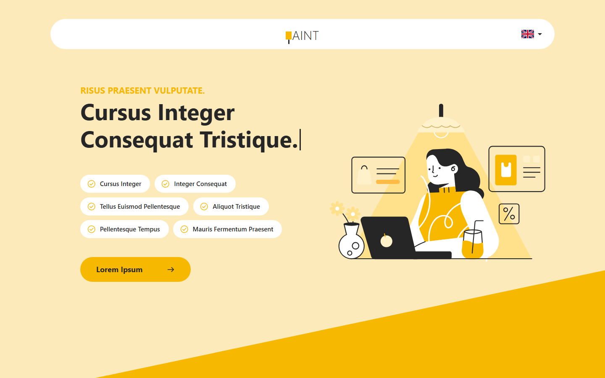

# Interactive website: responsive landing page

A responsive landing page coded from a free Figma design. This is a practice project made to show my front-end work: a layout with diagonal section edges, a mobile version and small interactions, all without a framework.

## What is inside

- Header with a language button, hero section with a typewriter heading
- Intro section, four numbered cards in two offset columns
- Customer review block with working arrows
- Benefits list, accordion FAQ (one item open at a time) and a call-to-action footer
- Diagonal section edges that stay in proportion on any screen width
- Smooth reveal on scroll and hover effects (turned off with `prefers-reduced-motion`)

## Tech

HTML, CSS (grid, flexbox, custom properties, `clip-path`) and vanilla JavaScript. No libraries. The desktop layout scales from the 1920 px design, the mobile layout follows the 375 px design.

## Screenshots

| Desktop (1440 px) | Mobile (375 px) |
|---|---|
| [desktop-full.png](screenshots/desktop-full.png) | [mobile-full.png](screenshots/mobile-full.png) |

## Run it

Open `index.html` in a browser. No build step is needed.

## What I did and what I added

- Coded the desktop and the mobile layouts from the two Figma frames.
- Added the animations, the typewriter heading, the accordion and the review slider.
- Wrote the answers of the collapsed FAQ items and two extra list items, which are not visible in the design.
- Redrew the logo and the flag icon, because they were not exported from the file.
- The font in the design looks like Segoe UI. The page uses Segoe UI with Open Sans as a fallback.

## Credits and license

- Design: [Freebie: Interactive website & mobile responsive designs](https://www.figma.com/community/file/1198413387972983198/freebie-interactive-website-mobile-responsive-designs) by [Imzul Design Agency](https://www.figma.com/@imzul), licensed under [CC BY 4.0](https://creativecommons.org/licenses/by/4.0/). I converted the design to code and added animations.
- Illustrations (named "DrawKit Vector Illustration" in the file), icons and the portrait photo come from the same Figma file. Their own sources and licenses are not stated in the export, so check the original file before reusing them.
- Code in this repository: written by Arina.
